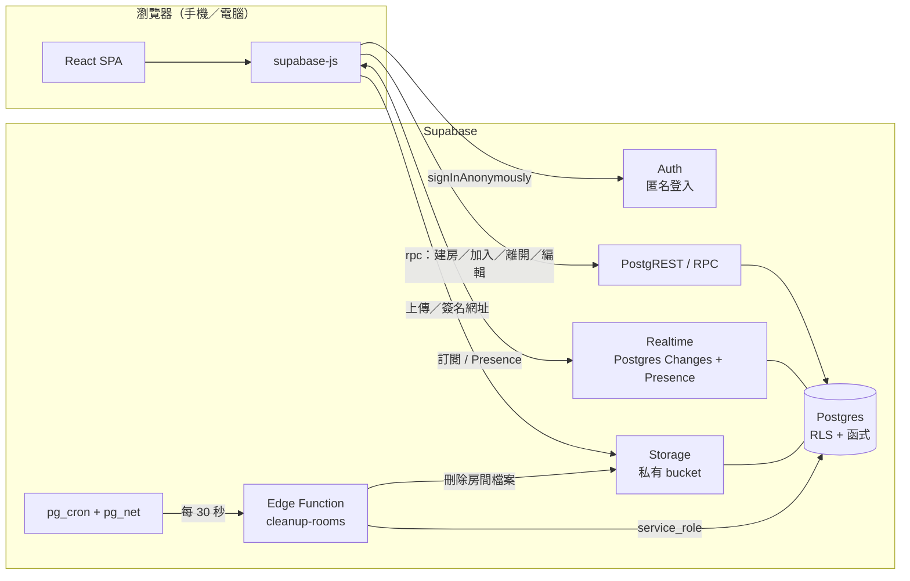
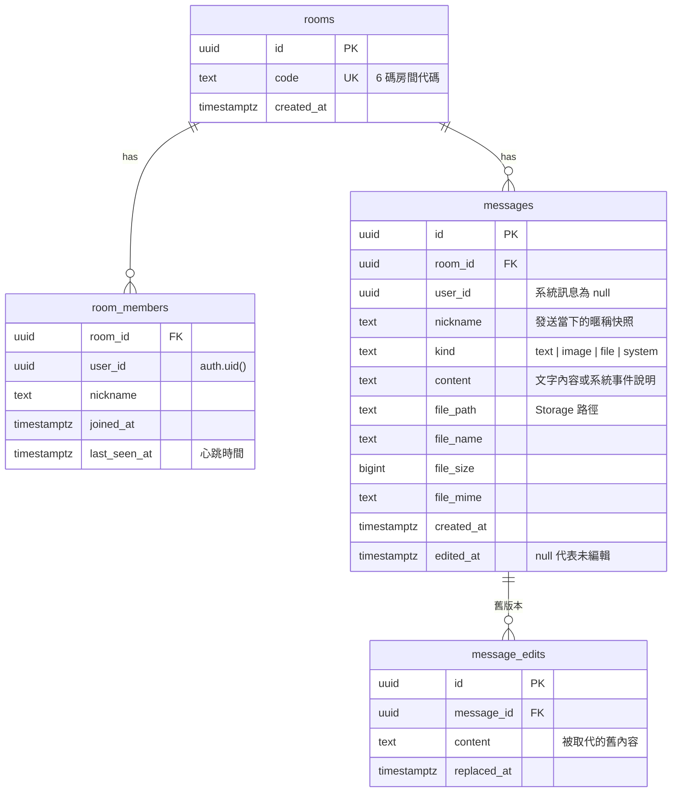

# 匿名聊天室 架構文件

## 1. 目標與範圍

一個免註冊的匿名聊天室。使用者填暱稱後，建立房間（系統產生代碼）或輸入代碼加入；房間內可即時傳文字、圖片、表情符號與檔案；所有人離開後，房間與內容全部清除。手機與電腦都要能用。

### 1.1 需求摘要（來自需求訪談）

| 面向 | 規則 |
|---|---|
| 進入 | 填暱稱 → 建立房間或輸入代碼加入 |
| 房間代碼 | 由系統產生，建立者取得並分享給他人 |
| 暱稱衝突 | 同房間重複時擋下，提示並建議「小明#2」，使用者確認或自行改名後才能進入 |
| 找不到房間 | 提示「找不到房間」，讓使用者選擇另外開房或重新輸入 |
| 人數 | 每房最多 20 人，滿了提示「房間已滿」 |
| 房間內 | 看得到在線名單與完整歷史紀錄（含加入前的訊息） |
| 內容 | 文字、圖片、表情符號、檔案，單檔上限 20MB，超過時提示 |
| 訊息顯示 | 暱稱、時間；自己的訊息靠右、不同顏色 |
| 編輯 | 只能編輯自己的訊息；顯示「已編輯」；其他人長按（電腦：右鍵或懸停）可看舊版本 |
| 進出通知 | 加入與離開都在聊天室顯示「誰＋時間」 |
| 離開 | 有「離開房間」按鈕 |
| 斷線 | 在線名單標示「斷線中」，不發離開通知；10 分鐘內重連保留身分，超時才算離開 |
| 清除 | 所有人離開，或全員斷線，房間與所有內容（含檔案）一併清除 |
| 裝置 | 手機與電腦皆支援 |

### 1.2 非目標

- 沒有帳號、密碼、好友、私訊。
- 沒有訊息刪除／收回功能（需求只要求編輯）。
- 沒有端對端加密。內容由伺服器保存直到房間清除，這點應在 UI 的說明文字中告知使用者。
- 不做推播通知。

## 2. 技術選型與理由

| 層 | 選擇 | 理由 |
|---|---|---|
| 前端 | React + TypeScript + Vite，Tailwind CSS | 單頁應用，不需要 SEO 或伺服器端渲染；Tailwind 方便做手機／電腦響應式版面 |
| 後端 | Supabase（Postgres、Auth、Realtime、Storage、Edge Functions） | 一個服務涵蓋資料庫、即時推送、檔案與排程，不用自己維護伺服器 |
| 身分 | Supabase 匿名登入（Anonymous Sign-ins） | 不需註冊就能拿到一個穩定的 `auth.uid()`，是「斷線重連保留身分」與 RLS 授權的基礎 |
| 即時訊息 | Realtime Postgres Changes（`messages`、`room_members`） | 訊息先寫入資料庫再推送，歷史紀錄與即時訊息共用同一份資料，沒有「漏收」的問題 |
| 在線狀態 | Realtime Presence | 專門處理「誰現在連著」，連線中斷會自動被移除，正好對應「斷線中」 |
| 檔案 | Supabase Storage（私有 bucket） | 內建大小限制與存取政策，可用短效簽名網址讀取 |
| 排程清理 | `pg_cron` + `pg_net` 呼叫 Edge Function | 清理要刪 Storage 檔案，必須用有權限的程式執行，不能只靠 SQL |
| 部署 | 前端靜態託管（Vercel／Cloudflare Pages），後端用 Supabase 託管服務，結構變更用 Supabase CLI migration 管理 | 沒有自建伺服器要維運 |

### 2.1 為什麼不自己寫 WebSocket 伺服器

自建伺服器需要處理連線管理、水平擴充、斷線偵測、檔案儲存與部署。這個專案的規模（房間小、人數上限 20）用不到那些彈性，Supabase 的 Realtime 加資料庫已足夠，也讓「房間資料隨時間清掉」變成單純的資料庫刪除。

### 2.2 為什麼用匿名登入，而不是只在前端存一個隨機 ID

只存前端 ID 的話，任何人都能偽造別人的 ID 來冒充發言或編輯他人訊息。匿名登入會發一個由伺服器簽發的 JWT，資料庫的 RLS 與 RPC 都能信任 `auth.uid()`，「只能編輯自己的訊息」才能在伺服器端強制執行，不是只靠前端按鈕隱藏。

## 3. 系統架構



### 3.1 職責切分

- **前端**：畫面、輸入檢查（暱稱長度、檔案 ≤ 20MB）、長按／右鍵操作、訂閱即時事件、每 20 秒送一次心跳。前端的檢查只是為了即時回饋，**所有規則都在伺服器端再次強制執行**。
- **資料庫函式（RPC）**：所有會改變房間成員狀態的動作（建房、加入、重連、離開、編輯訊息）。這些動作需要原子性（例如檢查人數上限再加入），不適合讓前端直接寫資料表。
- **RLS**：決定誰能讀、誰能寫哪些資料列。
- **Edge Function**：只負責定時清理（逾時成員、空房間、Storage 檔案）。

## 4. 資料模型



重點約束：

- `rooms.code` 唯一。
- `room_members` 主鍵為 `(room_id, user_id)`，另有唯一索引 `(room_id, lower(nickname))` 用來擋暱稱重複（不分大小寫）。
- 暱稱長度 1–20 字，由 CHECK 約束保證。
- `messages.nickname` 存快照而不是用外鍵：成員被移除後，歷史訊息仍能顯示正確的發送者。
- 所有子表對 `rooms` 設 `ON DELETE CASCADE`，刪房間即清掉成員、訊息、編輯歷史。

### 4.1 房間代碼

6 碼，字元集取 31 個容易辨認的字元（去掉 `0/O`、`1/I/L`），約 9 億種組合，足以讓隨機猜測不實際。由資料庫函式用密碼學安全的亂數產生，撞碼時重試。因為房間會被清除，代碼會被回收使用。

## 5. 核心流程

### 5.1 匿名身分

1. 前端啟動時，若本機沒有 session，呼叫 `signInAnonymously()`。
2. supabase-js 把 session 存在 localStorage，重新整理頁面後仍是同一個 `user_id`。
3. 同時把「目前所在房間代碼」存在 localStorage，供重連使用。

### 5.2 建立房間

`rpc('create_room', { nickname })`：在一個交易內產生唯一代碼、建立 `rooms`、把呼叫者加入 `room_members`、寫入「加入」系統訊息，回傳房間代碼。

### 5.3 加入房間

`rpc('join_room', { code, nickname })`，在一個交易內依序處理：

1. 以代碼找房間；找不到 → 回傳錯誤 `ROOM_NOT_FOUND`，前端顯示「找不到房間」並詢問「另外開一間」或「重新輸入」。
2. 鎖定該房間資料列（`SELECT … FOR UPDATE`），避免兩人同時搶最後一個名額。
3. 呼叫者已是成員 → 視為重連（見 5.6），直接回傳。
4. 成員數 ≥ 20 → `ROOM_FULL`。斷線中但尚未逾時的成員仍佔名額。
5. 暱稱已被使用 → `NICKNAME_TAKEN`，並附上建議值（找出最小的 n ≥ 2 使得 `暱稱#n` 未被使用）。前端顯示建議，使用者按確認或自行改名後重新呼叫。
6. 寫入 `room_members` 與「加入」系統訊息。

### 5.4 傳送與接收訊息

- **文字／表情符號**：表情符號就是 Unicode 文字，前端提供選取器，沒有額外後端工作。直接 `insert` 到 `messages`，RLS 要求呼叫者是該房成員、`user_id = auth.uid()`、且 `kind` 不能是 `system`。
- **圖片／檔案**：
  1. 前端先檢查 ≤ 20MB，超過則顯示「檔案太大（上限 20MB）」，不上傳。
  2. 上傳到 Storage `room-files/{room_id}/{uuid}-{原檔名}`。bucket 本身也設 20MB 上限，繞過前端檢查也傳不上去。
  3. 上傳成功後，插入一則 `kind = image | file` 的訊息，記錄路徑、檔名、大小、MIME。
- **接收**：所有成員訂閱該房間的 `messages` INSERT／UPDATE。Realtime 會套用 RLS，非成員收不到。
- **顯示檔案**：前端用 `createSignedUrl`（有效期例如 1 小時）取得暫時網址，不開放公開讀取。

### 5.5 編輯訊息

`rpc('edit_message', { message_id, new_content })`：

1. 確認訊息存在且 `user_id = auth.uid()`，否則拒絕；只有文字訊息可編輯。
2. 把舊內容寫入 `message_edits`，更新 `messages.content` 與 `edited_at`。
3. Realtime 推送 UPDATE，所有人的畫面更新並出現「已編輯」標記。
4. 其他人長按（觸控 ≥ 500ms）、右鍵或懸停該標記，前端查詢 `message_edits` 顯示舊版本。`message_edits` 的 RLS 與 `messages` 相同，僅同房成員可讀。

### 5.6 在線狀態、斷線與重連

「連著」與「身分還在」是兩件事，分別由兩個機制處理：

| 機制 | 用途 | 說明 |
|---|---|---|
| Presence | 即時顯示連線狀態 | 每個客戶端進房後在 `room:{code}` 頻道 `track` 自己。畫面上的在線名單 = `room_members`（身分仍有效者），其中**不在 Presence 內的人標示「斷線中」** |
| 心跳 `last_seen_at` | 讓伺服器知道誰還活著 | 客戶端每 20 秒呼叫輕量 RPC 更新自己的 `last_seen_at` |

**重連**：重新開啟頁面或網路恢復時，前端讀取 localStorage 的房間代碼，呼叫 `join_room`（5.3 第 3 步）。若 `room_members` 中還有自己，就恢復原暱稱與身分，不產生新的加入通知。超過 10 分鐘被移除後，就必須重新加入（可能要重新取暱稱，也可能撞名）。

**限制**：身分綁在這個瀏覽器的匿名 session 上。清除網站資料、換裝置或換瀏覽器，等同新使用者。

### 5.7 離開與清除

- **主動離開**：按「離開房間」→ `rpc('leave_room')`：刪除自己的 `room_members`、寫入「離開」系統訊息；若房間已無任何成員，立即刪除房間（連帶清除資料列）。前端同時呼叫 Storage 清理（見下），並回到暱稱／選房畫面。
- **被動離開（斷線超時）**與**全員斷線清除**，由排程處理：

`pg_cron` 每 30 秒透過 `pg_net` 呼叫 Edge Function `cleanup-rooms`（用 `service_role` 執行）：

1. 找出 `last_seen_at` 距今超過 **10 分鐘**的成員 → 刪除，並為每人寫入「離開」系統訊息（時間取實際移除時間）。
2. 找出**所有成員的 `last_seen_at` 都超過 60 秒**的房間（全員斷線）→ 刪除房間。
3. 對步驟 2 與主動離開後變空的房間，刪除 Storage 中 `room-files/{room_id}/` 底下所有檔案，再刪除房間資料列。先刪檔案、後刪資料列，這樣檔案刪除失敗時房間仍在，下一輪會重試，不會留下無人管理的孤兒檔案。

> **關於「全員斷線立即清除」的實際行為**：沒有任何客戶端連著時，伺服器無法即時得知，所以改用「心跳逾時」判定。全員斷線後約 **60–90 秒**內房間會被清掉，不是嚴格的零延遲。60 秒的寬限也避免手機切到背景、心跳被暫停的瞬間，就把房間誤判為空而刪掉。這個數字是可調整的常數。

## 6. 安全設計

### 6.1 金鑰處理

| 金鑰 | 放哪裡 | 原因 |
|---|---|---|
| Supabase URL、`anon`／publishable key | 前端環境變數（`VITE_*`），會被打包進公開的 JS | 這把金鑰設計上就是公開的，權限完全由 RLS 與函式決定，本身不具特權 |
| `service_role` key | **只存在 Edge Function 的 secret**，絕不進前端、程式庫或 `.env` 提交 | 它會繞過 RLS，外洩等於整個資料庫被接管 |
| 本機開發用的 `.env` | 加入 `.gitignore`，另提供 `.env.example` 只含變數名稱 | 避免誤提交 |

因為前端金鑰是公開的，**安全完全建立在 RLS 與 RPC 上**，不能假設「前端不會呼叫那個 API」。

### 6.2 存取控制（RLS）

所有表都啟用 RLS，預設拒絕。

| 資料 | 讀取 | 寫入 |
|---|---|---|
| `rooms` | 僅該房成員 | 不開放直接寫入（只能經 RPC） |
| `room_members` | 僅同房成員 | 不開放直接寫入（只能經 RPC；心跳也走 RPC，且只能更新自己那一列） |
| `messages` | 僅同房成員（含加入前的歷史） | 成員可插入自己的 `text/image/file` 訊息；修改只能經 `edit_message`；`system` 訊息只能由 RPC 寫入 |
| `message_edits` | 僅同房成員 | 僅 `edit_message` |
| Storage `room-files` | 僅同房成員（路徑第一段 = `room_id`，以此判斷） | 僅同房成員可上傳；bucket 強制 20MB 上限 |

「是否為同房成員」封裝成一個 `SECURITY DEFINER` 的輔助函式 `is_room_member(room_id)`，供各政策共用，避免政策之間互相遞迴查詢。所有 `SECURITY DEFINER` 函式都固定 `search_path`，防止被劫持。

Realtime 的 Presence 頻道也設為**私有頻道**，並在 `realtime.messages` 上以相同的成員規則授權，避免只知道代碼卻不是成員的人偷看在線名單。

### 6.3 濫用防護

| 風險 | 對策 |
|---|---|
| 腳本大量匿名註冊、建房、灌訊息 | 啟用 Supabase Auth 的匿名登入 CAPTCHA（如 Cloudflare Turnstile）與 Auth 速率限制；`create_room`、`join_room` 在函式內另做每使用者頻率限制 |
| 暴力猜房間代碼 | 約 10 億種組合 + `join_room` 頻率限制 + 失敗次數過多暫時拒絕 |
| 超大／大量檔案佔滿儲存空間 | bucket 單檔 20MB；房間會被清除，儲存空間自然回收；可再加每人每房總量上限 |
| XSS（暱稱、訊息、檔名） | React 預設會跳脫輸出，不使用 `dangerouslySetInnerHTML`；訊息內的連結只自動轉為 `rel="noopener noreferrer"` 的連結 |
| 惡意檔案 | 檔案一律以下載（`Content-Disposition: attachment`）處理，只有確認 MIME 為圖片時才行內預覽；不執行、不解析檔案內容 |
| 身分冒用 | 一律以 `auth.uid()` 判斷，不信任前端傳來的使用者 ID |

## 7. 前端結構

```
src/
  main.tsx
  lib/
    supabase.ts        # 建立 client、匿名登入、session 還原
    session.ts         # localStorage：目前房間代碼
  features/
    entry/             # 暱稱輸入、建房／輸入代碼、錯誤處理（找不到房間／已滿／暱稱衝突）
    room/
      RoomPage.tsx     # 版面：訊息區 + 在線名單 + 輸入列
      MessageList.tsx  # 訊息顯示、自己靠右上色、已編輯標記
      MessageActions.tsx # 長按／右鍵：編輯、看舊版本
      Composer.tsx     # 文字輸入、表情選取器、檔案選擇（20MB 檢查）
      MemberList.tsx   # 在線／斷線中
      useRoom.ts       # 訂閱 messages / members / presence、心跳、重連
  components/          # 共用元件
```

- **響應式**：手機為單欄，在線名單收進抽屜；桌面為訊息區 + 右側成員欄。
- **互動對應**：以 Pointer Events 實作 500ms 長按；桌面另外支援 `contextmenu`（右鍵）與滑鼠懸停。
- **事件處理**：訂閱建立後先載入歷史，再套用即時事件，並以 `message.id` 去重，避免歷史查詢與即時推送的時間差造成重複或漏訊息。
- **網路中斷**：偵測到離線時顯示「連線中斷，重新連線中…」，恢復後重新訂閱並補抓中斷期間的訊息（依 `created_at` 大於最後一則已收訊息）。

## 8. 錯誤對照

| 情境 | 伺服器回應 | 使用者看到 |
|---|---|---|
| 代碼不存在或房間已清除 | `ROOM_NOT_FOUND` | 「找不到房間」，可選「另外開一間」或「重新輸入」 |
| 房間滿 20 人 | `ROOM_FULL` | 「房間已滿」 |
| 暱稱重複 | `NICKNAME_TAKEN` + 建議值 | 「暱稱已被使用，建議使用『小明#2』」，確認或自行修改 |
| 檔案 > 20MB | 前端攔截；伺服器也拒絕 | 「檔案太大（上限 20MB）」 |
| 編輯他人訊息 | 拒絕 | 介面不顯示編輯入口；直接呼叫 API 也會失敗 |
| 重連時身分已逾時 | `join_room` 當新成員處理 | 回到加入流程，重新填暱稱 |

## 9. 已知取捨與風險

1. **清除不是即時的**：全員斷線約 60–90 秒後才清除（5.7），主動離開則是立即。
2. **身分綁定瀏覽器**：清除網站資料或換裝置就無法重連。這是匿名設計的必然結果。
3. **Postgres Changes 的擴充上限**：它依序處理變更並逐一檢查 RLS，在高流量下會成為瓶頸。以目前每房 20 人的規模足夠；若日後要支援大量房間，可改為由資料庫觸發器透過 Broadcast 推送。
4. **歷史紀錄隨加入者增加而變大**：新加入者要載入完整歷史。房間生命週期短，暫不分頁；若單房訊息很多，可改為「載入最新 N 則，往上捲動再載入更早」。
5. **檔案刪除可能延遲**：Storage 刪除失敗時，房間資料列會保留到下一輪排程重試，所以暫時不會有「資料列已刪、檔案還在」的孤兒檔案，但清除時間可能順延。
6. **Supabase 方案限制**：免費方案有單檔、儲存總量、Realtime 同時連線數等限制，上線前要對照實際方案確認 20MB 與預期人數是否受限。
7. **訊息內容不加密**：Supabase 管理者與資料庫能看到所有未清除的內容，隱私說明要誠實。

## 10. 測試重點

- **資料庫層（pgTAP 或整合測試）**：
  - 第 21 個人加入被拒；兩人同時搶最後名額只有一人成功。
  - 暱稱衝突（含大小寫）與建議值正確。
  - 非成員讀不到訊息、房間、檔案；成員不能編輯別人的訊息、不能寫入 `system` 訊息。
  - `edit_message` 正確保留舊版本。
  - 10 分鐘逾時移除、全員斷線清房、清房後檔案確實被刪。
- **前端**：
  - 長按、右鍵、懸停都能開啟舊版本。
  - 超過 20MB 不送出且有提示。
  - 斷網後重連能補回訊息、沒有重複。
  - 手機寬度與桌面寬度的版面。
- **手動情境**：兩個瀏覽器分頁模擬多人，拔網路線模擬「斷線中 → 重連」與「超時離開」。
